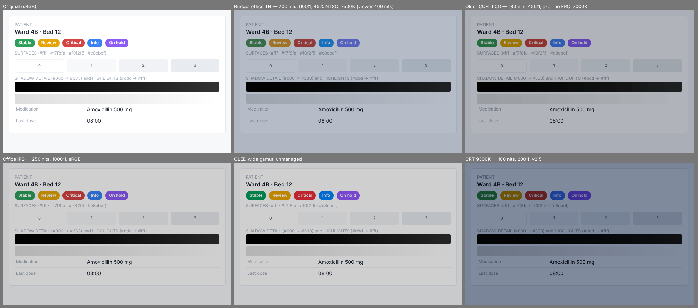

# Screen Quality

See how your interface reproduces on the displays your users actually have.
Screen Quality models the *limitations* of a target display — luminance, contrast, gamut, tone response,
white point, bit depth, chroma — and shows the result on yours. It is not a vintage filter.



## Install (Homebrew, macOS)

```bash
brew tap navajyoth-puthalath13/phosphor https://github.com/navajyoth-puthalath13/Phosphor
brew install screen-quality
```

This builds the CLI and compiles the native display helper (needs Xcode Command Line Tools, which Homebrew
already requires). Check the install with `brew test screen-quality`; update with `brew upgrade screen-quality`;
remove with `brew uninstall screen-quality && brew untap navajyoth-puthalath13/phosphor`.

### From source (development)

Requires Node ≥ 22.18.

```bash
git clone https://github.com/navajyoth-puthalath13/Phosphor.git
cd Phosphor          # skip if you are already in the folder
npm install          # installs dependencies and builds dist/
npm link             # puts `screen-quality` on your PATH
native/macos-helper/build.sh   # macOS: build the display helper
```

Don't have both installed at once: `npm unlink -g screen-quality` before `brew install`.

## Use

```bash
screen-quality detect                    # what is known — and unknown — about your displays
screen-quality detect --json             # the full Source Display Profile
screen-quality profiles                  # list target displays
screen-quality simulate shot.png -t budget-tn -o out.png --viewer-nits 400
```

`simulate` options: `--mode absolute|adapted`, `--only gamut,contrast`, `--disable luminance`.
Effects: `luminance, contrast, gamut, gamma, whitePoint, bitDepth, chroma`.

- Screenshots can be taken any way you like: an embedded colour profile (macOS tags screenshots with
  your display's, usually Display P3) is read and the image converted to sRGB first. Untagged PNGs are treated as sRGB.

Quick try on a Mac — capture the screen, then simulate it:

```bash
screencapture -x ~/Desktop/sq-test.png
screen-quality simulate ~/Desktop/sq-test.png -t budget-tn -o ~/Desktop/sq-budget-tn.png --viewer-nits 400
open ~/Desktop/sq-test.png ~/Desktop/sq-budget-tn.png
```
- `--viewer-nits` is the brightness of the display you are looking at. Without it, brightness differences are
  not simulated (software cannot read it); everything else still is.

## Develop

```bash
npm test                 # unit + CLI smoke tests
npm run typecheck
npm run sq -- profiles   # run the CLI from source, no build needed
```

## Docs

- [docs/display-model.md](docs/display-model.md) — the colour model, stage by stage, and what is not modelled
- [docs/ARCHITECTURE.md](docs/ARCHITECTURE.md) — layout, decisions, milestone status

## Development

Project skills live in `.claude/skills/` (Ponytail, addyosmani/agent-skills, Graphify). Graphify's CLI is
installed separately: `uv tool install graphifyy`.
