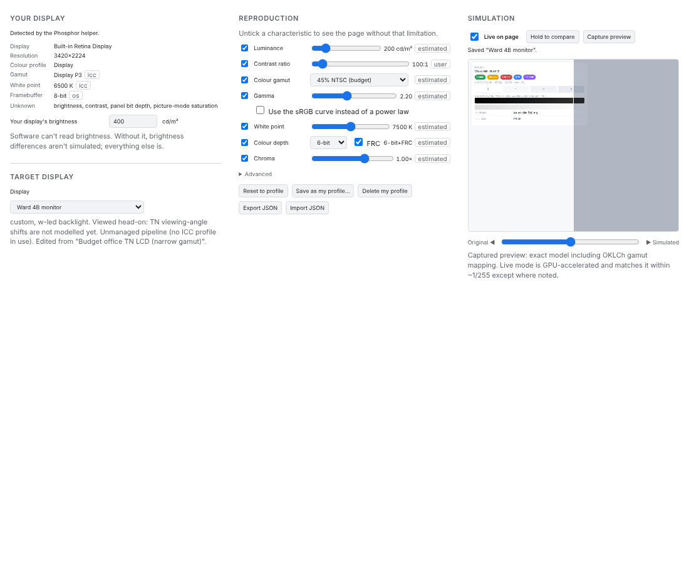
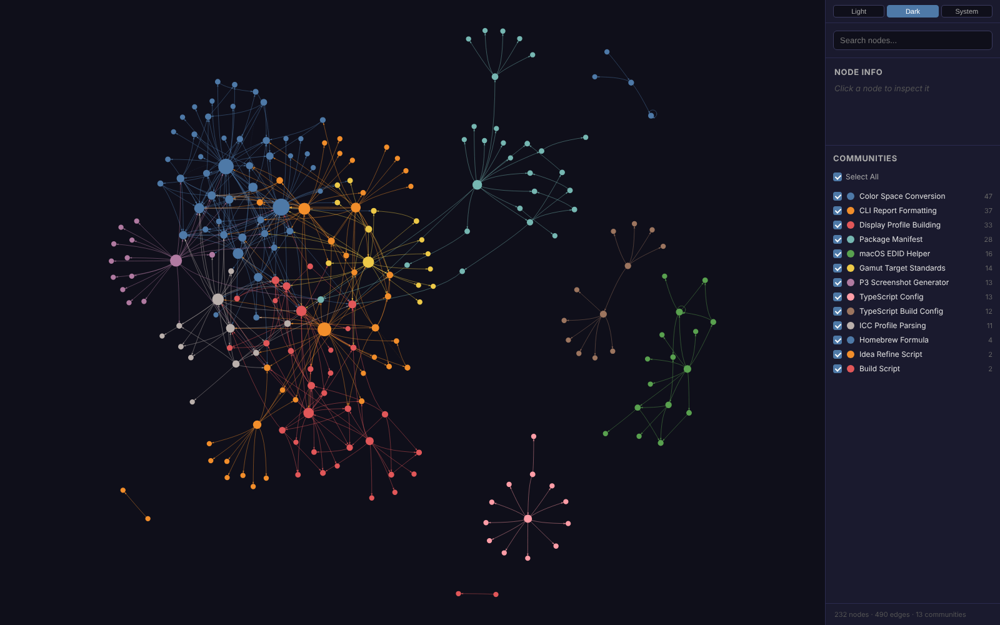

# Phosphor

See how your interface reproduces on the displays your users actually have — right inside Chrome DevTools.

A screen you design on (say a MacBook's Display P3 panel) can be far better than the budget office monitor,
old CCFL LCD or CRT your users sit in front of. Phosphor models the **limitations** of a target display —
luminance, contrast, gamut, tone response, white point, bit depth and chroma — and shows your live page through
them, so you can catch labels that vanish, borders that merge and status colours that stop being distinguishable.
It is not a vintage filter: every effect comes from a physical display model, and every value says where it came from.



## Install (macOS)

**1. Install with Homebrew**

```bash
brew tap navajyoth-puthalath13/phosphor https://github.com/navajyoth-puthalath13/Phosphor
brew trust --formula navajyoth-puthalath13/phosphor/phosphor
brew install navajyoth-puthalath13/phosphor/phosphor
```

**2. Connect your browser and add the DevTools extension**

```bash
phosphor setup
```

`setup` connects the display helper to every Chromium browser you have (Chrome, Edge, Brave, Arc, Chromium),
opens `chrome://extensions` and copies the extension's folder path to your clipboard. Then, once:

1. turn on **Developer mode** (top right of `chrome://extensions`);
2. click **Load unpacked**, press ⌘⇧G, paste, press Return.

Browsers never let a program install an extension by itself — you always confirm it. Check everything with
`phosphor doctor`, and run `phosphor setup` again after `brew upgrade phosphor`.

**3. Use it:** open any page → right-click → **Inspect** → the **Phosphor** tab (in the `»` menu if it's hidden).

<details>
<summary>Install troubleshooting</summary>

- `brew trust` is required: Homebrew refuses formulas from third-party taps until you approve them. It approves
  only this one formula — read [`Formula/phosphor.rb`](Formula/phosphor.rb) first if you want to see what it runs.
- *"Your Command Line Tools are too outdated"*: update them in System Settings → General → Software Update, or
  `sudo rm -rf /Library/Developer/CommandLineTools && sudo xcode-select --install`.
- Check the install: `brew test navajyoth-puthalath13/phosphor/phosphor`
- Remove everything: `brew uninstall phosphor && brew untap navajyoth-puthalath13/phosphor`, then remove the
  extension in `chrome://extensions` and the folder `~/Library/Application Support/Phosphor`.
</details>

## The DevTools panel

| Section | What it does |
|---|---|
| **Your display** | what the helper detected (resolution, colour profile, gamut, white point) and what software can't know. Enter your screen's brightness to simulate dimmer displays. |
| **Target display** | a generic display class or one of your saved profiles |
| **Reproduction** | the seven characteristics, each with a slider and an on/off tick: luminance (cd/m²), contrast ratio, colour gamut (sRGB, Display P3, Adobe RGB, Rec. 2020, budget 45% NTSC, CRT/CCFL, or your own primaries), gamma (or the sRGB curve), white point (5000–10000 K), colour depth (6/8/10-bit, FRC), chroma. Every value shows where it came from: `standard`, `estimated`, `user`… |
| **My profiles** | *Save as my profile*, delete, and *Export / Import JSON* to share a profile with your team |
| **Simulation** | **Live on page** — the page itself changes; layout, scrolling and clicks keep working. **Hold to compare** shows the original while held. **Capture preview** — an exact still with a draggable original/simulated split. |

`phosphor guide` prints this list in the terminal.

Live mode compiles the display model into a GPU filter and matches the exact model within ~1/255 on 99–100% of
pixels (measured in Chromium). It clips colours outside sRGB instead of gamut-mapping them, and applies chroma with
the browser's saturation filter; the captured preview has neither approximation.

**Target displays** — generic classes, not specific models; every value is from a standard or an estimate with its
reason in [`packages/display-profiles/targets.ts`](packages/display-profiles/targets.ts):

| Target | Key limitations |
|---|---|
| Ideal sRGB display | none — identity check |
| Standard office IPS (W-LED) | 250 nits, 1000:1 |
| Budget office TN LCD | 200 nits, 600:1, ~45% NTSC gamut, cool 7500 K white |
| Older CCFL office LCD (2005–2010) | 180 nits, 450:1, 6-bit without FRC (banding) |
| Office VA monitor | 250 nits, 3000:1 |
| Wide-gamut OLED, not colour-managed | over-saturates sRGB content |
| CRT monitor, 9300 K preset | 100 nits, 200:1, gamma 2.5, bluish white |

Measured a real monitor? Save it as your own profile with its measured values — they're tagged `user`.

## Command line

```bash
phosphor detect                       # what is known — and unknown — about your displays
phosphor profiles                     # list target displays
phosphor profiles --export budget-tn  # a profile as JSON, to edit into your own
phosphor simulate shot.png -t budget-tn -o out.png --viewer-nits 400
phosphor simulate shot.png --target-file my-monitor.json -o out.png
```

`simulate` options: `--viewer-nits N` (your display's brightness), `--mode absolute|adapted`,
`--only gamut,contrast` / `--disable luminance`. Screenshots may carry a colour profile (macOS tags them with your
display's, usually Display P3); Phosphor converts them to sRGB first.

## Chrome Web Store

Phosphor isn't on the Chrome Web Store yet, which is why setup uses **Load unpacked** — free, fully functional,
and the normal way to run an extension during development. Publishing needs a Chrome Web Store developer account
(a one-time US$5 fee), a privacy policy page and Google's review. Once listed, `phosphor setup` opens the store page
instead and the install becomes one "Add to Chrome" click; nothing else changes. Microsoft Edge Add-ons is a free
store that runs the same extension.

## What's new

**0.2.0**
- **Chrome DevTools panel** with all seven controls, per-effect toggles, provenance tags and a captured preview.
- **Live website reproduction**: the display model compiled into a GPU filter on the page; layout and interaction untouched.
- **Custom target profiles**: save, delete, export and import in the panel; `profiles --export` and `simulate --target-file` in the CLI. Imported profiles are validated with clear errors.
- **`phosphor setup` / `doctor` / `guide`**: browser connection (native messaging), guided extension install, setup checks.

**0.1.0**
- Renamed from *Screen Quality* to **Phosphor**; Homebrew formula.
- Verified on a MacBook Air (macOS 27); fixed the Swift helper build, ICC v2 white point, and Display P3 screenshots.
- Engine 1 (detection: EDID, ICC v2/v4, provenance) and Engine 2 (reproduction: physically ordered colour pipeline).

## How it's built

```
apps/cli/                       the phosphor command, setup, and the browser's native host
apps/devtools-extension/        the Chrome extension: DevTools panel, background worker, live layer
engines/display-detection/      Engine 1: raw display facts → Source Display Profile
engines/display-reproduction/   Engine 2: pixels or a live page + target profile → simulated output
packages/                       shared: profile schema, colour math, ICC reader, target profiles + validation
native/macos-helper/            Swift helper that reads CoreGraphics, ColorSync and IOKit (EDID)
Formula/phosphor.rb             Homebrew formula
```

The two engines never import each other; both depend only on `packages/`. A code map made with
[Graphify](https://github.com/Graphify-Labs/graphify):



Details: [docs/display-model.md](docs/display-model.md) (the colour model and what is not modelled) ·
[docs/ARCHITECTURE.md](docs/ARCHITECTURE.md) (decisions and milestone status).

## Develop

Requires Node ≥ 22.18 (it runs TypeScript directly).

```bash
git clone https://github.com/navajyoth-puthalath13/Phosphor.git && cd Phosphor
npm install                      # dependencies + builds dist/ and dist/extension/
npm test                         # unit, real-hardware and CLI tests
npm run typecheck
npm run check:browser            # live filter + extension end to end in Chromium (needs Playwright)
npm run cli -- setup             # connect your browser to this checkout
native/macos-helper/build.sh     # macOS: build the display helper
```

Explore the code graph: `uv tool install graphifyy && graphify extract . --code-only && graphify cluster-only . && open graphify-out/graph.html`.
Project agent skills live in `.claude/skills/` (Ponytail, addyosmani/agent-skills, Graphify).

## Status

Done: display detection, the reproduction engine, live and captured simulation, the DevTools panel, custom
profiles, Homebrew install and browser setup. Not yet: Chrome Web Store listing, specific monitor models (need
datasheet or measured data), viewing-angle and ambient-light modelling, automatic findings (e.g. "these two status
colours become indistinguishable"). Results show the *likely* degradation for a class of display — visual-testing
insights, not a physical measurement or accessibility certification.
