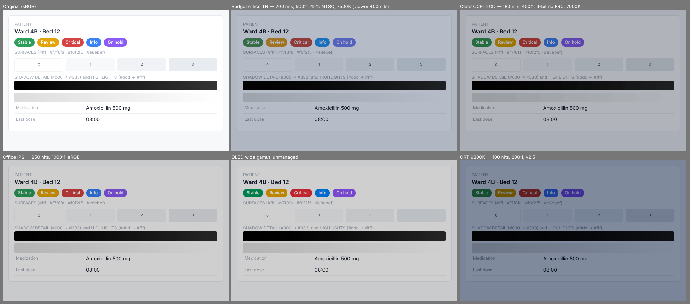

# Display reproduction model (Engine 2)

Phosphor does not apply visual effects. It computes, for each colour, **the light a target display
would emit** for the signal a website sends it, then asks the viewer's display to emit that light.

*`tests/fixtures/clinical-ui.png` through each generic target, absolute mode, 400-nit viewer.*

## Stages (physical signal-flow order)

| # | Stage | Model | Parameter(s) | Source file |
|---|---|---|---|---|
| 0 | Content | 8-bit pixels; if the PNG embeds an ICC profile (macOS screenshots: the display's, usually Display P3) they are converted to sRGB first (relative colorimetric, gamut-mapped) | embedded profile | `content.ts` |
| 1 | OS colour management | If the target is colour-managed: sRGB → target RGB, relative colorimetric (Bradford D65 → target white), clipped — what ColorSync/ICM do. Unmanaged targets (typical Windows office PC) receive sRGB values untouched. | `colourManaged` | `stages.ts` |
| 2 | Picture-mode chroma | OKLab chroma × gain at constant L and hue | **chroma** | `stages.ts` |
| 3 | Panel quantisation | round to 2ⁿ−1 levels; FRC = time-average = n+2 bits | **bit depth**, dithering | `stages.ts` |
| 4 | Tone response | signal → channel light: sRGB curve or power law | **gamma** | `stages.ts` |
| 5 | Panel colorimetry | linear RGB → XYZ via the panel's primaries and white (normalised Y=1) | **gamut**, **white point** | `stages.ts` |
| 6 | Luminance & black | `XYZ = Lw·((1−k)·XYZrel + k·Wrel)`, `k = 1/CR` (additive black at white chromaticity) | **luminance**, **contrast** | `stages.ts` |
| 7 | Viewer rendering | *absolute*: divide by viewer white (cd/m²), keep chromaticity. *adapted*: Bradford target white → D65, divide by `Lw` | viewer nits, mode | `stages.ts` |
| 7b | White fit | if the target white can't be emitted (e.g. 9300 K needs blue > 1), scale the whole image once — as ICC absolute-colorimetric proofing does — instead of clipping per pixel | — | `pipeline.ts` |
| 8 | Output gamut mapping | CSS Color 4 style: reduce OKLCh chroma at constant L, h until inside sRGB; counted and reported | — | `stages.ts` |
| 9 | Encode | linear → sRGB 8-bit; the OS then colour-manages the PNG to the viewer's real display using its ICC profile | — | `pipeline.ts` |

The spec (§8.1) lists the transformations in a different order (gamut → luminance → contrast → gamma →
white → depth → chroma). That order is not how a display works — e.g. quantisation happens on the
drive signal *before* the panel's tone curve — so the code follows signal flow. Every stage is still a
separate pure function with its own tests (`stages.test.ts`).

## Live mode

The DevTools panel's *Live on page* compiles the same resolved parameters into an SVG filter on the page's root
element (`engines/display-reproduction/filter.ts`): one table per channel for stages 2–4 on sRGB-encoded values, and
one colour matrix in linearRGB for stages 5–7 plus the white fit (they are all linear in light, so they fold into a
single affine map). Measured in Chromium against the CPU engine on the clinical page: 99–100% of flat-area pixels within
2/255 (`tests/browser/live-filter.check.ts`). Two approximations, reported in the panel: colours outside sRGB are
clipped instead of OKLCh-mapped, and a non-neutral chroma uses the browser's saturate filter.

## Disabling an effect

Turning an effect off substitutes the ideal sRGB reference value (sRGB primaries, D65, sRGB curve,
8-bit, chroma 1, infinite contrast, luminance = viewer). Tests prove that with every effect off, every
target reproduces the input to within 1 code value, and the `srgb-reference` target reproduces it exactly.

## Why the viewer's luminance matters

"This display is dimmer" is only meaningful relative to the display you are looking at. If the source
display's luminance is unknown (it almost always is — software cannot read it), the luminance effect is
**not simulated** and a warning says so. Pass `--viewer-nits` (or measure your display) to enable it.

*Absolute* mode shows what reaches the eye if you could put both displays side by side. *Adapted* mode
models an observer who has adapted to the target's own white and peak: tints and dimness vanish, but
raised black, gamma, gamut, banding and chroma remain. Real perception lies between the two.

## Not modelled (yet) — and why

- **Viewing angle** (TN/VA gamma and colour shift): needs angle-dependent measured data per panel class.
- **Ambient light / screen reflectance**: raises effective black further; needs a lux input and panel reflectance.
- **OLED ABL and per-channel black chromaticity**: a fixed full-field luminance and white-coloured black are used.
- **CRT scanlines, curvature, blur**: geometry/optics — decorative without a calibrated optical model (spec §15.12).
- **Viewer black level**: the viewer display's own black is assumed to be 0, so raised blacks are slightly understated
  on a poor viewer display and exact on OLED/mini-LED viewers.
- **Display P3 output**: output is sRGB only, so wide-gamut targets are gamut-mapped even when the viewer is P3.
  The canvas path (Milestone 5) can output `display-p3`.

None of this is a physical measurement. Results show *likely* degradation for a class of display; they are
visual-testing insights, not accessibility certification.
